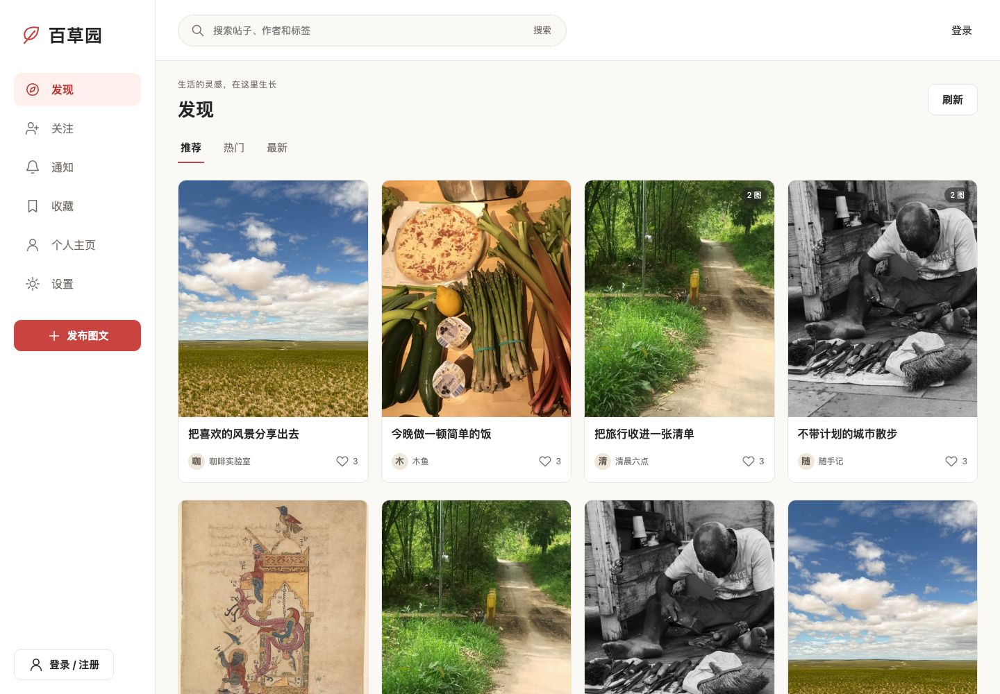

# 百草园 · 图文社区平台

百草园（TIP，Text-Image-Platform）是一个使用 Vue 3 与 Django 构建的图文社区项目。它包含内容发布、评论互动、用户关系、通知和社区治理功能，并提供推荐模型训练相关代码。



<p align="center"><em>桌面端发现页（本地公开素材演示内容）</em></p>

## 功能概览

- **内容创作：** 发布和编辑图文、图片上传与排序、草稿自动保存、失败恢复。
- **社区互动：** 评论与回复、点赞、收藏、关注、搜索、分享和分页浏览。
- **账号与通知：** 注册登录、邮箱验证与密码恢复、个人资料、持久化通知。
- **内容治理：** 举报、审核、申诉、角色权限与审计记录。
- **响应式界面：** 桌面和窄屏布局，包含发现、详情、创作、个人主页、通知及管理页面。
- **推荐实验：** 提供交互数据处理与 ALS 离线训练代码。当前社区信息流使用真实内容热度规则；模型训练和生产级在线推荐仍在迭代。

## 界面截图

上面的截图展示桌面端发现页。演示内容由 `seed_demo_data --reset` 生成，图片来自公开许可素材，用户、标题、正文和互动均为本地演示数据。

## 技术栈

| 层级 | 技术 |
| --- | --- |
| 前端 | Vue 3、TypeScript、Vite、Vue Router、Element Plus |
| 后端 | Django 5.2、Django REST Framework、Session 认证、SQLite（本地默认） |
| 媒体处理 | Pillow、Django Storage |
| 推荐训练 | Python、NumPy、Pandas、SciPy、scikit-learn、implicit、Optuna |
| 自动检查 | GitHub Actions、Django 测试、前端类型检查与构建 |

## 项目结构

```text
Text-Image-Platform/
├── backend_django/       # Django API、社区业务、管理命令和迁移
├── frontend_vue/         # Vue 单页应用
├── recommend_system/     # 推荐数据处理与离线训练代码
├── demo_assets/          # 可复现展示内容的公开许可图片
├── docs/                 # 公开文档、API 契约、UI 规范及桌面截图
│   ├── assets/readme/     # README 使用的桌面端截图
│   └── local/            # 本地开发过程记录（Git 忽略，不随克隆提供）
├── .github/workflows/    # CI 工作流
├── .gitignore            # 本地配置、运行产物和过程文档排除规则
├── requirements.txt      # Python 依赖
├── run_project.sh        # 本地启动脚本
└── .env.example          # 环境变量模板
```

## 本地运行

### 环境要求

- Python 3.11
- Node.js 20.19+（或 22.12+）
- npm

### 安装并启动

```bash
git clone https://github.com/Gotit-zhx/Text-Image-Platform.git
cd Text-Image-Platform
cp .env.example .env
bash run_project.sh --install
```

启动脚本会安装后端和前端依赖、执行 Django 迁移并启动本地开发服务：

- 前端：<http://127.0.0.1:5173>
- 后端：<http://127.0.0.1:8000>

按 `Ctrl+C` 可停止服务。默认使用 SQLite 和本地媒体存储，适合开发与体验；请先查看 `.env.example` 和[开发运行说明](docs/DEVELOPMENT_GUIDE.md)，再按需要调整本地配置。

### 填充展示内容

服务启动后，在项目根目录执行：

```bash
cd backend_django
../.venv/bin/python manage.py seed_demo_data --reset
```

该命令只清理旧的本地演示账号和帖子，保留 staff/superuser，然后导入 `demo_assets/` 中的公开图片并生成适合展示的图文、评论、点赞、收藏和关注关系。演示账号密码为 `DemoGarden!2026`，不要在生产环境使用。

### 分别启动前后端

后端：

```bash
cd backend_django
python3 -m venv .venv
source .venv/bin/activate
pip install -r requirements.txt
python manage.py migrate
python manage.py runserver 127.0.0.1:8000
```

前端（在另一个终端执行）：

```bash
cd frontend_vue
npm ci
npm run dev
```

## 测试与构建

运行后端测试：

```bash
cd backend_django
python manage.py test
```

检查前端类型并生成生产构建：

```bash
cd frontend_vue
npm ci
npm test
```

GitHub Actions 会安装依赖、执行数据库迁移、运行 Django 测试并构建前端。

## 文档

- [文档索引与目录约定](docs/README.md)
- [快速开始](docs/QUICK_START.md)
- [开发与运行说明](docs/DEVELOPMENT_GUIDE.md)
- [项目概览](docs/PROJECT_OVERVIEW.md)
- [详细项目说明](docs/PROJECT_DETAILS.md)
- [API 契约](docs/API_CONTRACT.md)
- [UI 规范](docs/UI_SPEC.md)
- [演示图片来源与许可](docs/demo-media-sources.md)

仓库保留运行、使用和维护所需的公开文档。开发提示词、任务清单、实施记录和人工验收记录保留在本地；新增过程文档统一放入 `docs/local/`，由 `.gitignore` 排除。数据库、上传文件、开发邮件、日志、环境密钥和测试产物同样不提交。自动化测试源码、数据库迁移、依赖锁文件及公开图片许可说明继续纳入版本控制。

## 项目状态与范围

项目处于持续开发阶段。当前仓库包含社区业务、治理流程和自动化检查；完整人工验收、实体手机与辅助技术检查仍在进行。推荐模型在线化、生产部署与并发容量也仍在迭代。
